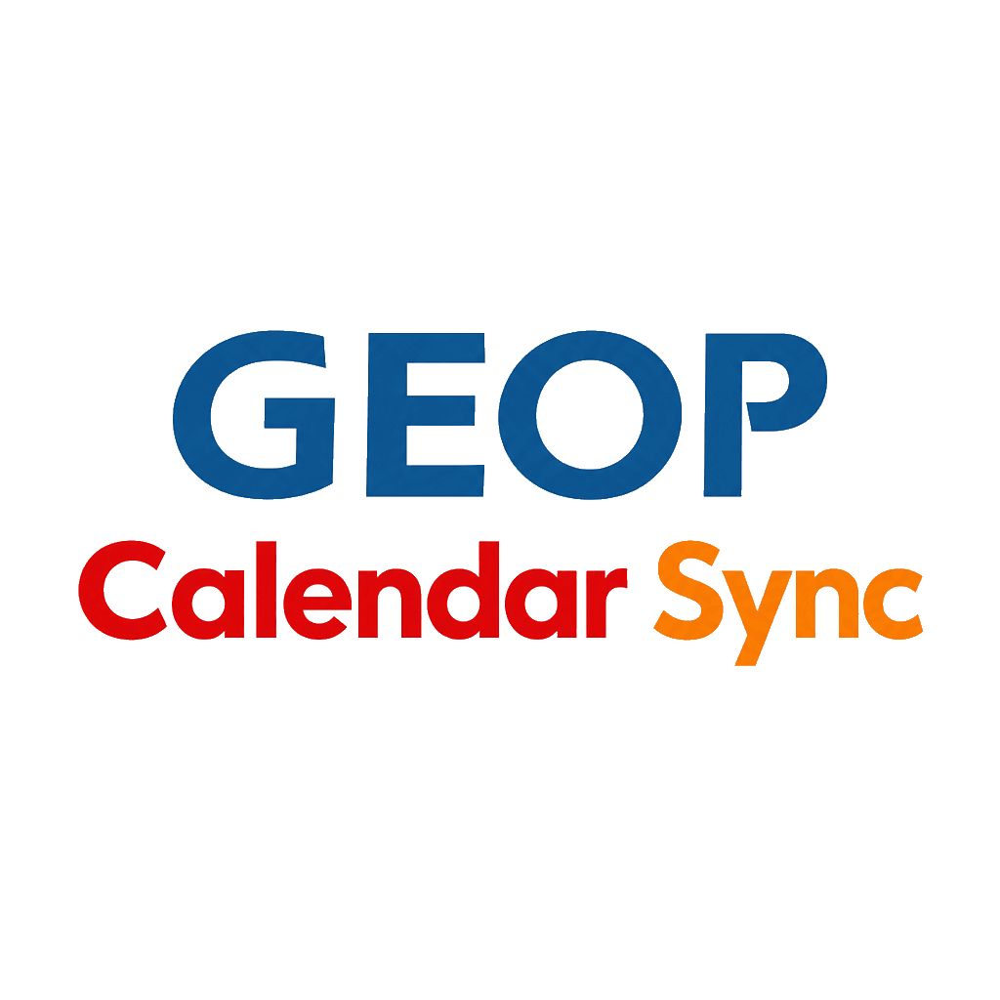

  

<h1 align="center">GEOP-CalendarSync</h1>

<em>Progetto indipendente da GEOP.</em>

Importa il calendario delle lezioni di GEOP su Google Calendar o Apple Calendar.

## Versione online

Puoi utilizzare il progetto direttamente su [dencode.it/geopsync](https://dencode.it/geopsync), senza installare nulla.

*[!] Nota: Non salviamo email e password GEOP. Conserviamo solo il calendario importato per renderlo disponibile.*

> **[INFO] Preferisci usare il tuo computer?**
>
> Installa la versione locale per avere il pieno controllo sui dati del calendario e sull’esecuzione del progetto.

## Installazione

1. Installa **PHP 8.3 o successivo**, con le estensioni **cURL** e **DOM**, e rendi disponibile il comando `php` nel PATH.
2. Scarica il progetto ed estrai la cartella sul computer.

## Avvio

1. Avvia `start.cmd` su Windows oppure esegui `sh start` dal terminale nella cartella del progetto su Linux/macOS.
2. Nella pagina che si apre, inserisci le credenziali GEOP e segui le indicazioni per importare il calendario.

<em>Se non si apre automaticamente, visita <a href="http://127.0.0.1:8080">http://127.0.0.1:8080</a>.</em>

---

⭐ <strong>Il progetto ti è stato utile? Lascia una stella su GitHub!</strong>

